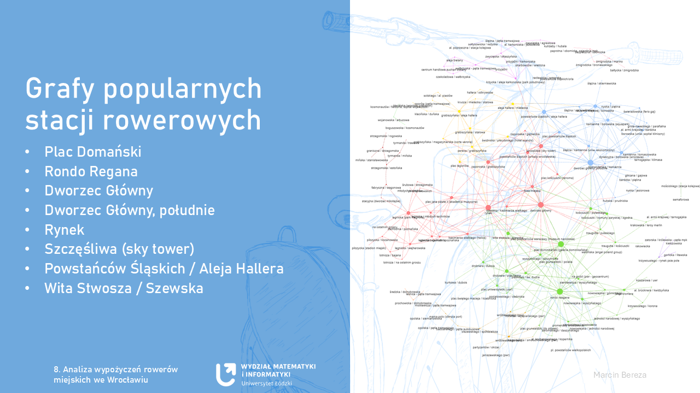
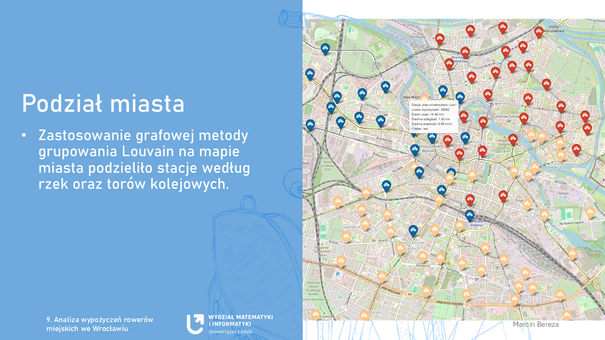
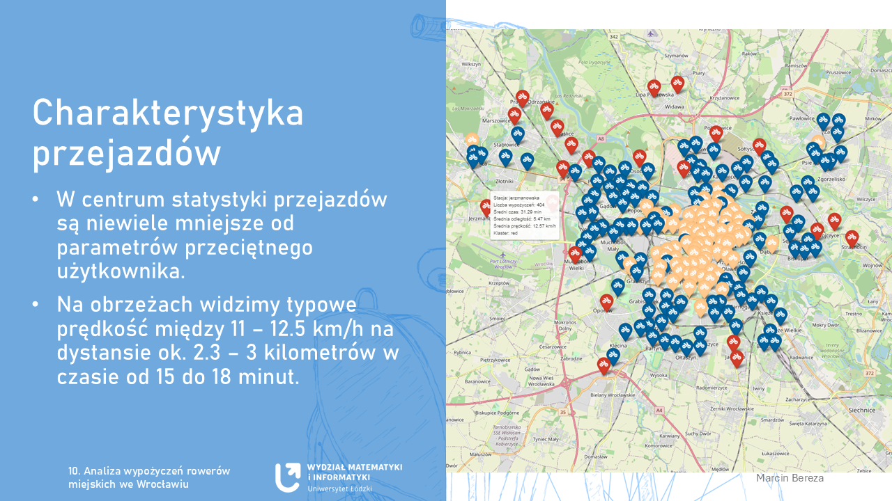
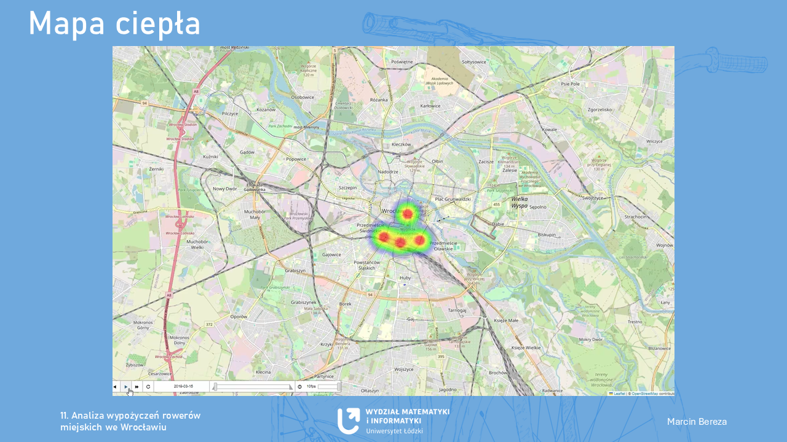
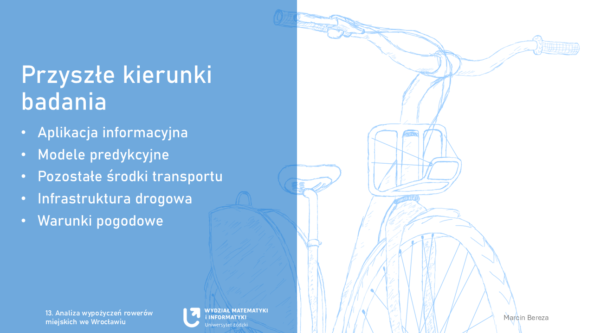

## Analiza wypożyczeń rowerów miejskich we Wrocławiu - metody statystyczne i wizualizacja danych
Systemy wypożyczalni rowerowych stają się coraz częściej integralną częścią infrastruktury miejskiej. Służą one użytkownikom jako ekonomiczny, wygodny i przyjazny środowisku środek transportu.

Analiza zależności i schematów ich wykorzystania są nie tylko wartością poznawczą, ale także kluczową wiedzą do lepszego zarządzania i usprawnienia systemu.

W pracy skupiamy się na procesie przygotowania i integracji danych, aby zapewnić użyteczność zbioru. Identyfikujemy zależności i zachowania użytkowników, wykorzystując metody analizy danych oraz techniki uczenia bez nadzoru, które pozwalają na odkrycie nieznanych schematów.

Klasteryzacja oraz utworzone wizualizacje przestrzenne umożliwiły wyodrębnienie różnych grup stacji oraz lepsze zrozumienie systemu rowerowego.

Przeprowadzona analiza pozwoliła na odkrycie niewidocznych wcześniej informacji o wypożyczeniach, ale także sformułować zalecenia, które usprawnią system i zoptymalizują jego działanie.

